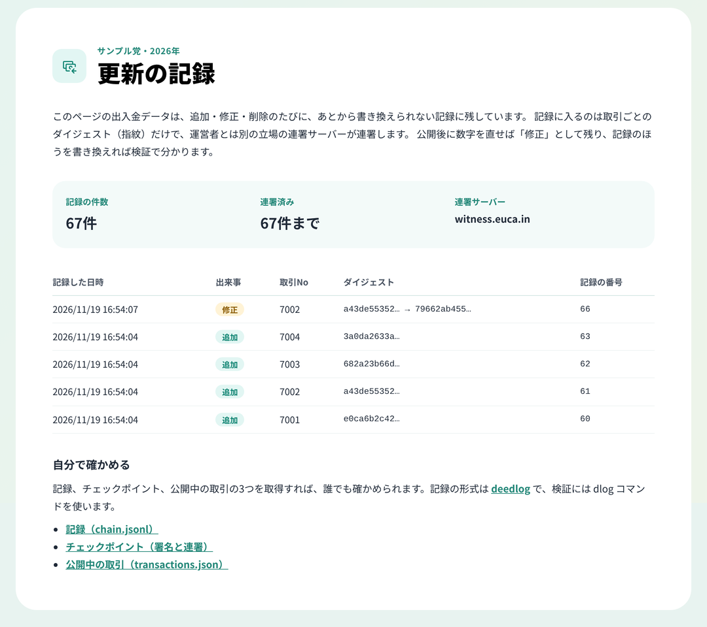

# 公開データの更新の記録（deedlog 連携）デモ

作成: 2026-11-19。Issue #613「決裁者追跡と改ざん検知可能な監査ログによる透明性強化」のうち、
「改ざんを検知できる追記専用の記録」と「外部の人が独立に検証できること」を、動く形で示すための実装メモ。
承認者の追跡（誰が起案し、確認し、承認したか）は、この実装の範囲外。

## 何をするか

公開サイトに出している取引（収入・支出）が追加・修正・削除されるたびに、その取引のダイジェストを
追記専用の記録に 1 行ずつ残す。記録の形式は [deedlog](https://github.com/eucassoc/deedlog) のチェーンで、
運営者が署名したチェックポイントに、運営者とは別の立場の連署サーバーが連署する。

これで、公開サイトだけを相手に、誰でも次の 2 点を確かめられる。

1. 記録が、連署されたチェックポイントと一致する（あとから書き換えられていない）
2. いま公開されている取引が 1 件ずつ、記録の最後の状態と一致する（記録を通さずに変えられていない）

公開サイトの「更新の記録」ページ（家賃を直して取り込み直したあと。団体・取引は架空）:



## 記録に入るもの

取引 1 件につき、次の JSON（キーはこの順、空白なし、UTF-8）の SHA-256。公開サイトの CSV と同じ項目に、
取引No を足したもの。取引の中身は記録に入らない。

```json
{"year":2026,"no":"7002","date":"2026-04-25","type":"expense","amount":80000,"account":"事務所費","friendly_category":"家賃","label":""}
```

記録の 1 行（deedlog evidence chain v0.1）:

```json
{"spec":"deedlog/v0.1","chain":"marumie.example/ledger","seq":61,"prev":"sha256:…","collected_at":"2026-11-19T05:25:41Z","source":{"type":"marumie","id":"admin","collector":"marumie-ledger/0.1"},"subject":{"media_type":"application/json","size":140,"digest":{"sha256":"…"}},"meta":{"event":"transaction.created","org":"sample-party","year":"2026","no":"7002"}}
```

`meta.event` は `transaction.created` / `transaction.updated`（`replaces` に直前のダイジェスト）/
`transaction.deleted`。先頭の 1 行（`ledger.opened`）は、何を記録するかの宣言のダイジェスト。

## 作り

| 場所 | 役割 |
|---|---|
| `shared/ledger/ledger.ts` | ダイジェストの元の作り方、行の組み立て、記録の読み直し、公開データとの差分（純粋な処理） |
| `prisma`: `ledger_records`、`ledger_checkpoints` | 記録の行（作ったときの文字列のまま）と、連署済みのチェックポイント |
| admin `shared/application/usecases/sync-ledger-usecase.ts` | いまの公開データと記録を比べ、足りない出来事を追記する |
| admin `shared/presentation/ledger/record-ledger.ts` | 取引を書き換える action（CSV 取り込み、削除、一括削除、全削除、同期用 JSON の取り込み）から呼ぶ入口。`LEDGER_CHAIN` が未設定なら何もしない |
| webapp `/ledger/chain.jsonl`、`/ledger/checkpoint` | 記録とチェックポイントの公開 |
| webapp `/o/[slug]/[year]/ledger/transactions.json` | 記録と突き合わせるための、公開中の取引の書き出し |
| webapp `/o/[slug]/[year]/ledger` | 「更新の記録」ページ |
| `scripts/ledger/anchor.mjs` | チェックポイントを作り、連署を受けて保存する定期ジョブ（署名の鍵を持つのはこれだけ） |
| `scripts/ledger/verify.mjs` | 公開サイトだけを相手にした検証 |

記録は「書き換えた処理が自分で報告する」形ではなく、「公開データと記録の差を見て追記する」形にしている。
取引を書き換える経路が増えても記録の漏れが起きず、データベースを直接書き換えた場合も、次の追記で
「修正」として残るか、それまでのあいだ検証で食い違いとして見えるかのどちらかになる。

## 動かし方

`docs/getting-started.md` のとおりにローカル環境を作ったうえで:

```sh
go install github.com/eucassoc/deedlog/cmd/dlog@v0.1.0   # Go 1.24 以上
echo 'LEDGER_CHAIN=marumie.example/ledger' >> admin/.env.local
pnpm db:migrate:deploy
pnpm dev                                                  # webapp :3000 / admin :3001
scripts/ledger/demo/run.sh /tmp/ledger-demo
```

デモは 4 つの場面を順に見せる（登場する団体・取引はすべて架空）。

1. 会計ソフトの CSV を管理画面から取り込む。追加が記録に載り、連署を受け、検証が通る
2. 公開後に金額を直して取り込み直す。「修正」として記録に残り、検証は通る
3. 管理画面を通さず、データベースの金額を直接書き換える。検証が「公開中の内容が記録と違う」と示す
4. 直した事実そのものを消すため、記録を作り直す。連署サーバーは連署せず、検証も通らない。
   運営者が作り直した記録に自分で署名すれば、控えを持つ人が運営者の公開鍵だけで不正を証明できる

実行結果（要点だけ抜粋）:

```text
場面 1: 会計ソフトの CSV を管理画面から取り込む。取引の追加が記録に載り、連署を受ける
witness.example	cosigned
66 件までのチェックポイントに連署を受けて保存しました
✓ 記録は連署されたチェックポイントと一致します（marumie.example/ledger、66 件、うち 66 件まで連署済み）
✓ 公開中の取引 4 件は、すべて記録と一致します（sample-party・2026年）

場面 2: 公開後に家賃を 80,000 円から 85,000 円に直して取り込み直す。「修正」として記録に残る
witness.example	cosigned
67 件までのチェックポイントに連署を受けて保存しました
✓ 記録は連署されたチェックポイントと一致します（marumie.example/ledger、67 件、うち 67 件まで連署済み）
✓ 公開中の取引 4 件は、すべて記録と一致します（sample-party・2026年）

場面 3: 管理画面を通さず、データベースの金額を直接 12,000 円から 2,000 円に書き換える。公開データが記録と食い違う
✓ 記録は連署されたチェックポイントと一致します（marumie.example/ledger、67 件、うち 67 件まで連署済み）
✗ 公開中の取引と記録が 1 件食い違っています（sample-party・2026年）
  ・取引No 7003: 公開中の内容が記録（62 番）と違う

場面 4: 家賃を直した事実そのものを消すため、記録を作り直す。連署サーバーは連署せず、検証も通らない
記録を書き換えました: 67 件 → 66 件（取引No 7002 の「修正」を消去）
✗ 記録が、連署されたチェックポイントと一致しません
  dlog: chain.jsonl: FAILED: chain has 66 records, checkpoint covers 67
witness.example	FAILED: witness has already cosigned a larger tree (67 > 66)
連署を受けられませんでした。チェックポイントは保存していません。

場面 4 の続き: 運営者が作り直した記録に自分で署名すると、控えを持つ人は運営者の公開鍵だけで不正を証明できる
MISBEHAVIOR PROVEN: marumie.example/ledger signed checkpoints of sizes 67 and 66 with different records at index 61
```

## 公開しているデモの記録

このブランチを架空のデータで動かした記録（場面 2 までの、正しい状態のもの）を、EUCA の連署サーバー
witness.euca.in に登録し、連署を受けて公開している。

- 説明と検証の手順: https://deedlog.org/demo/marumie/
- witness.euca.in の確認ページ: https://witness.euca.in/#o=deedlog.org/demo/marumie
- 記録の名前: `deedlog.org/demo/marumie`。記録そのものを公開する形（`"kind": "direct"`）で登録している

```sh
node scripts/ledger/verify.mjs --url https://deedlog.org/demo/marumie --org sample-party --year 2026 \
  --key operator.vkey --witness witness.vkey
```

## デモを Vercel と Supabase に立ち上げる

公開サイト（webapp）だけを、公開しているデモの記録と同じデータで動かす。管理画面（admin）は立ち上げない。

1. Supabase で新しいプロジェクトを作る。接続文字列を 2 つ控える（Connect の画面）:
   プール経由（Transaction pooler、ポート 6543）と、直接（Direct connection、ポート 5432）。
2. Vercel で、このフォークを Import する。
   - Root Directory: `webapp`
   - Settings → Git → Production Branch: `deedlog-demo`
   - Environment Variables（Production）:

     | 名前 | 値 |
     |---|---|
     | `DATABASE_URL` | プール経由の接続文字列に `?pgbouncer=true&connection_limit=1` を付けたもの |
     | `DIRECT_URL` | 直接の接続文字列（ビルド時のマイグレーションに使う） |
     | `DATA_REFRESH_TOKEN` | 長いランダムな文字列 |
     | `WEBAPP_URL` | デモの URL（例: `https://marumie-demo.vercel.app`） |
     | `DEMO_NOTICE` | `これは EUCA によるデモで、チームみらいの公式サイトではありません。データはすべて架空です。` |
     | `DEMO_NOTICE_URL` | `https://deedlog.org/demo/marumie/` |
     | `MANUAL_DEPLOY` | `1`（`webapp/vercel.json` の ignoreCommand が、本番への自動デプロイを止めないように） |

3. 一度デプロイする。ビルドの `prisma migrate deploy` でテーブルができる（データはまだ空）。
4. Supabase の SQL Editor で `scripts/ledger/demo/marumie-demo-data.sql` を流す（`psql` でもよい）。
   何度流しても同じ行は二重に入らない。
5. Vercel で Redeploy する。データの入った状態でページが作り直される。
6. `/ledger/chain.jsonl` と `/ledger/checkpoint` が、https://deedlog.org/demo/marumie/ledger/ のものと
   同じであることを確かめる（同じデータなので、バイト単位で一致する）。

`DEMO_NOTICE` があると、全ページの下端に注意書きが出続け、検索エンジンには載らない（robots で拒否、
noindex）。チームみらいの公式サイトと取り違えられないためのもの。

## 本番で使うなら決めること

- **連署サーバー**: `run.sh` はローカルの `dlog witness` を使う。実運用では、運営者と利害の異なる組織の
  連署サーバー（C2SP の witness プロトコルに対応したもの。上の公開デモでは witness.euca.in）に、
  記録の名前と公開鍵を登録する。
- **チェックポイントのジョブ**: Vercel の関数は dlog を実行できないので、鍵を持つ別のジョブ
  （GitHub Actions の定期実行など）から動かす。公開 URL から記録を読む形にすれば、データベースへの
  接続は保存のときだけで済む。
- **時刻**: `collected_at` は運営者の申告。信頼できる時刻が要るなら、チェックポイントに RFC 3161 の
  タイムスタンプを押す（`dlog timestamp`）。
- **記録の読み直し**: 追記のたびに全行を読んでいる。件数が増えたら、団体ごとの最新状態を別に持つ。
- **範囲**: 取引だけを記録している。残高、取引先、調査研究広報滞在費の仕訳の公開・公開取り消しは対象外。
- **守れないもの**: 取り込む前の会計データが正しいかどうかは、この記録からは分からない。
  示せるのは「公開したものが、その後どう変わったか」。
